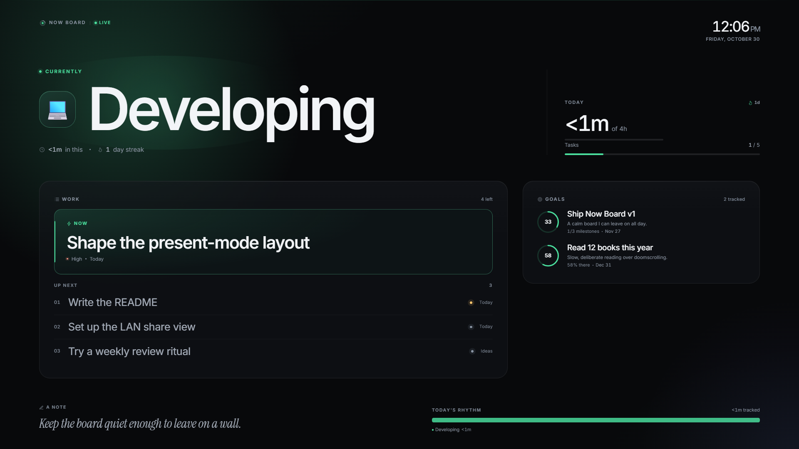
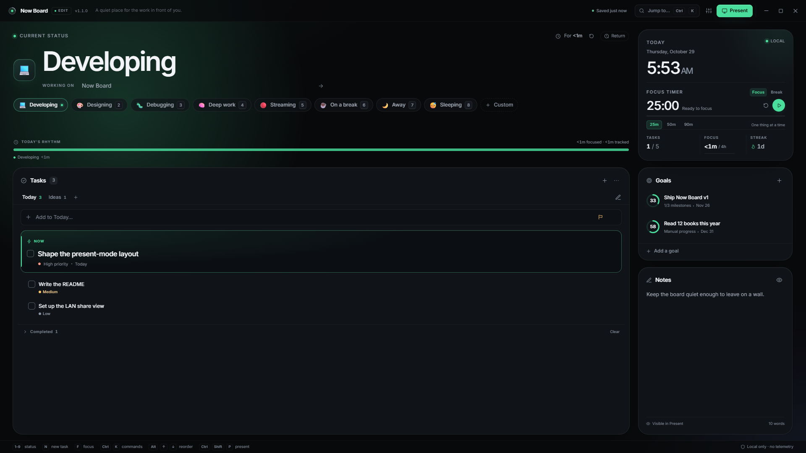
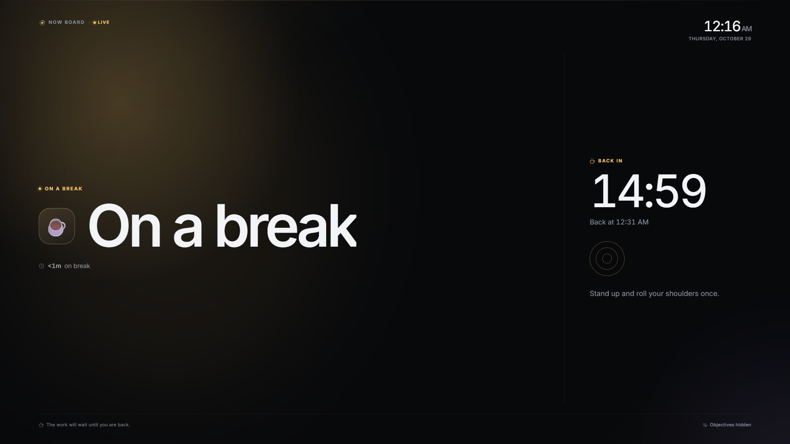
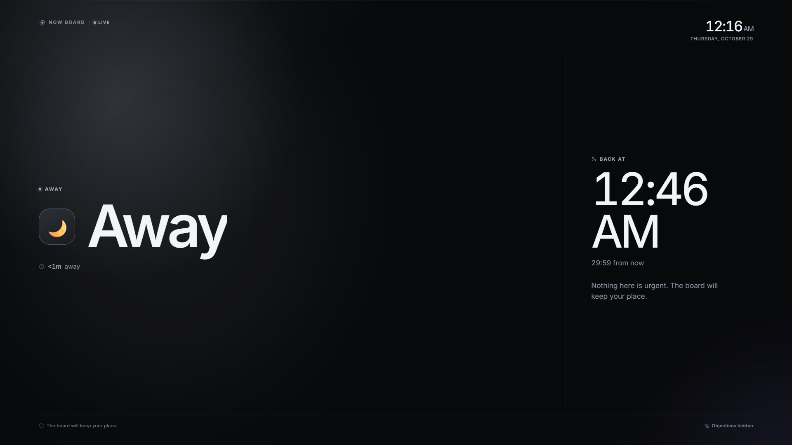
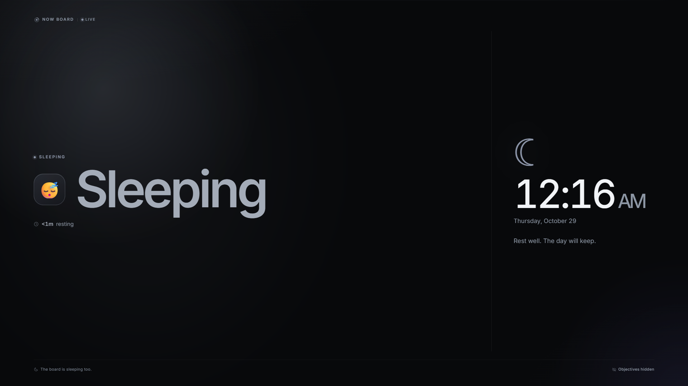

# Now Board

**A calm, local-first focus board for a second monitor.**

Now Board is a premium desktop focus board with two faces: a quiet, read-only
**Present** mode built for a wall display or screen share, and a fast,
keyboard-first **Edit** mode for running the day. Everything lives on your
machine in a plain JSON file. No account, cloud, telemetry, or network request
is required.





The current development version adds areas for organizing lists and goals,
goal-linked tasks, and goal status and progress views. These new panels are not
yet release-ready: their styling and goal editor interaction need work. Version
1.1 added a daily focus target, a system/12-hour/24-hour clock
setting, a customizable board name, native timer and return-time notifications,
global quick capture, sleep-aware wake times, and faster keyboard quick modes.

Break, away, and sleeping statuses replace the work board with a quiet scene
built for the same distance. Objectives, tasks, progress, notes, and the work
timeline are not rendered in Present or published to the LAN view.

| On a break | Away | Sleeping |
| --- | --- | --- |
|  |  |  |

## What it does

### Present mode

- One large current status with an elapsed timer and optional subline.
- Dedicated break, away, and sleeping scenes with a calm prompt, return
  countdown, or dim clock.
- A live clock, focus timer, session streak, daily rhythm timeline, and a daily
  focus goal with progress while in a focus status.
- The clock follows the system or can be forced to 12-hour or 24-hour time.
- The current focus task, up-next work, task progress, goals, milestones, and a
  private-or-public note while in a focus status.
- Status-aware return and wake times: short break options, longer away options,
  6/7/8/9-hour sleep options, and a custom clock time. The return time appears in
  Edit, Present, the LAN view, and the tray tooltip; passing it does not silently
  change the status.
- Optional native notifications when a focus/break timer ends or a return/wake
  time arrives. They contain no task, goal, or note text and stay on the
  machine.
- Stable geometry tuned for 1080p, 4K, narrow displays, and video compression.
- Optional per-section visibility, fullscreen, cursor hiding, and always-on-top.
- Every task, goal, and note can be marked private. Private items never reach
  Present mode or the LAN share snapshot.
- One-key **Panic** screen: “Be right back” hides the entire board instantly.

### Edit mode

- Status presets on `1`–`9`, including **On a break**, **Away**, and **Sleeping**,
  or a custom label, emoji, color, and kind.
- A status-aware return/wake menu with quick options and a custom clock time,
  plus break, away, sleeping, and focus quick modes from the command palette,
  tray, and local keyboard.
- A daily focus goal with progress in Today and Present; choose Off or 30-minute
  increments up to eight hours in Settings.
- Focus and break timer duration presets (25/50/90 minutes for focus,
  5/15/30 for breaks); choosing a new duration re-arms the timer.
- A completion toast that offers the natural next step: **Take 5** after focus,
  or **Start focus** after a break.
- Automatic status-session history and a compact daily timeline.
- Multiple task lists, drag reordering, priorities, a pinned **Now** task,
  quick add, inline rename, and per-task privacy.
- Goals with milestones, descriptions, target dates, and progress.
- Notes with a private/public switch.
- Command palette, keyboard navigation, visible focus rings, toasts, empty
  states, and focused dialogs.
- Dark and light themes, eight accent palettes plus a status-derived accent,
  gradient or solid backgrounds, ambient motion, reduced motion, comfortable or
  compact density, 85–130% text scaling, a custom board name, and a clock format.
- Focus timer keys (`f` to start/pause, `Shift+F` to reset), local quick modes
  (`b` break, `a` away, `s` sleeping, `r` return to focus), an optional tray icon
  with live status, close-to-tray behavior, and a one-click desktop shortcut
  creator.
- Global quick capture (`Ctrl+Alt+N`) and a tray **Capture a task…** item bring
  the cursor straight to quick add. The tray can also pause or resume the timer.
- Atomic saves, daily backups, JSON import/export, archived reset, and backup
  restore. The data folder is revealed from Settings, never from Present.

## Run it

### Portable Windows build

Build the app locally:

```powershell
npm install
npm run package
```

Then run:

```text
release\Now Board-win32-x64\Now Board.exe
```

The portable folder must stay together. There is no installer and no
auto-updater. The build is unsigned, so Windows SmartScreen may ask you to
confirm the first launch: **More info → Run anyway**.

To launch it from the desktop, use **Settings → Behavior → Desktop shortcut**,
or create the same shortcut from source after packaging:

```powershell
npm run shortcut
```

The shortcut points at the current `release\Now Board-win32-x64\Now Board.exe`.
If you move the portable folder, recreate the shortcut. Now Board runs a tray
icon while it is open; its menu can open the board, capture a task, pause or
resume the timer, toggle Present, show Panic, start a focus session, take a
break, step away, enter Sleeping, or quit. The tray tooltip follows the current
status and return/wake time. Enable **Close to tray** to keep the app available
when the window is closed.

### Development

Requirements: Windows 11, Node.js 22+ (developed on Node 24), and npm 10+.

```powershell
npm install
npm run dev          # Vite renderer + Electron shell
```

Production renderer preview inside Electron:

```powershell
npm run build
npm start
```

## Keyboard

### Global (when enabled)

| Shortcut | Action |
| --- | --- |
| `Ctrl+Shift+P` | Toggle Present / Edit |
| `Ctrl+Shift+B` | Toggle Panic screen |
| `Ctrl+Alt+O` | Open / focus the running board |
| `Ctrl+Alt+N` | Quick capture a task (opens Edit with quick add focused) |

Windows may reserve one of these for another app. Settings reports any failed
registration; the same actions remain available in-app. The global Open
shortcut only works while Now Board is running. The tray icon and desktop
shortcut cover the closed-app case.

### In the app

| Shortcut | Action |
| --- | --- |
| `1`–`9` | Apply a status preset, including break, away, and sleeping (Edit mode) |
| `n` | Focus quick add (Edit mode) |
| `b` | Take a 5-minute break (Edit mode) |
| `a` | Step away for 30 minutes (Edit mode) |
| `s` | Enter Sleeping (Edit mode) |
| `r` | Return to a 25-minute focus session (Edit mode) |
| `f` | Start or pause the focus timer (Edit mode) |
| `Shift+F` | Reset the focus timer (Edit mode) |
| `Ctrl+K` | Command palette; includes break, away, sleeping, and focus quick modes |
| `Ctrl+,` | Settings |
| `Ctrl+Shift+P` | Toggle Present |
| `Ctrl+Shift+B` | Panic |
| `Esc` | Close overlay, leave Present, or dismiss Panic |

`Tab`, `Shift+Tab`, arrow keys, `Enter`, and `Space` work throughout the UI.
Text fields are skipped by single-key shortcuts.

## Privacy and local share

Everything is local by default. Now Board does not contact a server, collect
analytics, or read unrelated files.

The optional **Share on your network** setting starts a read-only HTTP server on
your LAN (default port `4781`). It serves:

- the built read-only Present view at `/share`,
- one sanitized Present snapshot at `/api/state`.

The share server never serves the editor. `/`, `/index.html`, and unknown routes
redirect to `/share`; malformed URLs return `400`; writes return `405`; responses
use a strict CSP, `noindex`, `nosniff`, and `no-store`.

Private tasks, private goals, and private notes are removed before the snapshot
is published. Break, away, and sleeping statuses publish a quiet scene instead of
the work board: goals, tasks, task stats, notes, timeline history, streak, and
daily focus progress are removed or zeroed in the snapshot and never rendered in
Present/LAN view. The status
**subline is intentionally public**; do not put sensitive text there while
sharing or screen sharing.

Return and wake times are also part of the snapshot so every display shows the
same cue. They are display metadata only; Now Board does not switch status or
start a timer automatically when the time passes.

Desktop notifications are generated by the Electron main process and stay on the
machine. They never include task, goal, note, or status-subline text. The quick
capture global shortcut brings the app forward but does not transmit anything.

The LAN view has no login and no TLS. Enable it only on a trusted private
network. Windows Firewall may ask for permission the first time. Panic hides the
local board but does not stop the share server; turn sharing off when you are
finished.

## Data, backups, and recovery

The live board is one versioned JSON document (`STATE_VERSION = 5`) stored in
Electron's `userData` folder. Settings shows the exact location under **Data**.
Version 5 adds areas, goal-linked tasks, and goal status.
Version 3 adds the board name, clock format, daily focus target, and notification
preference. Version 2 added the sleeping status kind and return times; older
boards normalize missing fields and keep working.

- Saves are debounced and written atomically through a temporary file and
  rename, so a crash cannot leave a half-written `board.json`.
- The first successful save of each day copies the previous board to
  `backups/board-YYYY-MM-DD.json`.
- The 20 newest daily backups are retained; older backup files are pruned.
- Reset and restore archive the current file under `archives/` before replacing
  it atomically. Archives are not pruned automatically.
- Import accepts a JSON file up to 8 MB. It tolerates a UTF-8 BOM and raw JSON
  text, validates the shape, clamps unsafe values, and keeps a working board if
  the import fails.
- Export writes a readable JSON snapshot.
- Set `NOW_BOARD_DATA_DIR` to use a different data directory (useful for tests
  and portable profiles).

Delete old archives from the data folder when they are no longer useful.

The browser build falls back to `localStorage`; that path exists for visual
testing and development, not as the recommended desktop storage.

## Design and engineering notes

- **Shell:** Electron with a frameless window. Present is full-bleed; window
  controls exist only in Edit.
- **Renderer:** React 19, TypeScript, Vite, and hand-written CSS tokens. No UI
  framework or utility CSS.
- **Main process:** plain CommonJS (`electron/main.cjs`) so packaging needs no
  second TypeScript build. The preload exposes a narrow, validated IPC bridge.
- **State:** typed reducer, defensive normalization, selectors that build a
  privacy-filtered Present view model, and localStorage fallback.
- **Fonts:** bundled Inter variable and Instrument Serif; no runtime font
  requests.
- **Accessibility:** semantic controls, keyboard reachability, focus-visible
  styling, empty/loading/error states, reduced-motion support, and muted text
  tokens checked for WCAG AA contrast on their surfaces.
- **Packaging:** `@electron/packager` produces a portable Windows x64 build;
  a dependency-free Node script generates the PNG/ICO icon.
- **Performance:** the board is designed to sit idle at roughly zero CPU. No
  always-on `backdrop-filter` or large `filter: blur()` layers, ambient drift is
  opt-in, and React only ticks once a second while a countdown is live.
  Chromium background throttling is requested back whenever no timer or LAN share
  needs sub-minute updates.

See [DECISIONS.md](DECISIONS.md) for the reasoning behind the larger choices and
[PROGRESS.md](PROGRESS.md) for the build and verification log.

## Scripts

| Command | Purpose |
| --- | --- |
| `npm run dev` | Vite + Electron development |
| `npm run build` | Typecheck and build the renderer |
| `npm start` | Run Electron against the built renderer |
| `npm run typecheck` | TypeScript, no emit |
| `npm run lint` | ESLint |
| `npm test` | Vitest unit and route tests |
| `npm run verify` | Typecheck, lint, tests, build |
| `npm run screenshots` | Playwright Electron captures of Edit, Present, and quiet scenes at three sizes |
| `npm run screenshots:variants` | Light, compact, 130%, palette, focus, quiet-privacy, motion, fullscreen checks |
| `npm run icon` | Regenerate `build/icon.png` and `.ico` |
| `npm run package` | Build and produce `release/Now Board-win32-x64/` |
| `npm run shortcut` | Create a desktop shortcut to the packaged app |
| `npm run verify:share` | End-to-end LAN share, quiet-mode scrubbing, privacy, routing, and CSP check |
| `npm run verify:packaged` | Launch the packaged app, check save, shortcut, tray, screenshot |

The screenshot and verification scripts drive a real Electron window with
Playwright. `screenshots/` is generated and git-ignored. The packaged verifier
expects `npm run package` to have been run first; the share verifier expects a
current `dist/`.

## Known limits

- Windows x64 portable build only; no native installer, signing, or auto-update.
- Single machine, single instance. No cloud sync, accounts, or mobile app.
- LAN share is read-only, unauthenticated, and plain HTTP on a trusted LAN.
- Present privacy is item-level. The status subline is public by design. Quiet
  statuses hide goals, tasks, stats, notes, and work panels, but the status label,
  subline, and return time remain public.
- Return times are cues only. They do not auto-change status or auto-start a timer;
  optional local notifications can alert you when they pass.
- The newest 20 daily backups are kept; archives are kept indefinitely.
- Global Open works only while the app is running. The desktop shortcut starts
  it from cold, but points at the current release folder.
- Launch-at-login, the tray, and global shortcuts are verified on Windows 11;
  other platforms are untested. Desktop shortcut creation is Windows-only.
- If the renderer cannot reach the main process, the app falls back to
  localStorage; Electron is the supported production path.

## License

MIT. See [LICENSE](LICENSE).
